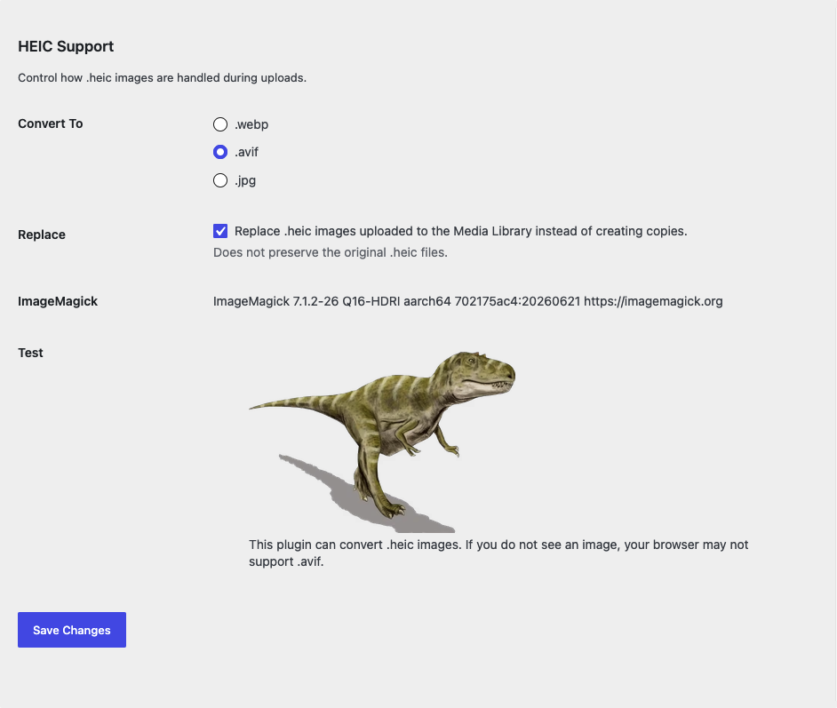
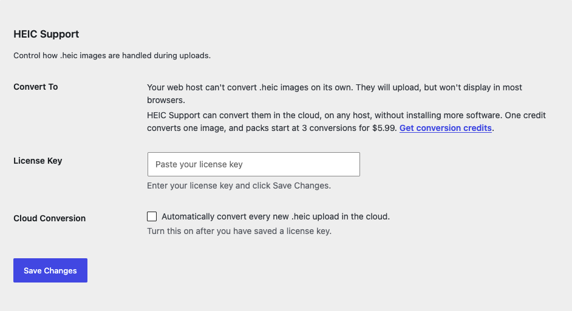
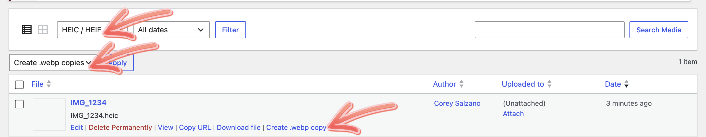

# HEIC Support

Allows .heic uploads to the Media Library. Creates .webp, .avif, or .jpg copies of .heic images when they are uploaded. Images already in the library can be converted one at a time, or in bulk with Create copies in the list view.

An optional feature replaces the original upload instead of creating a copy. Replace mode also converts sideloaded files, including `media_handle_sideload()` and `wp media import`. An iPhone file named `IMG_1234.HEIC` is saved with the converted extension, and the new attachment uses the converted file's MIME type. On PHP 8.5, a rename that only changes the case of a `.heic` extension no longer causes the upload to be rejected.

Creation of .webp, .avif, or .jpg copies usually works on servers running ImageMagick 7 or above. Check Settings → Media → HEIC Support after activating to see if your server provides ImageMagick.

Saves attachment IDs in meta key `_heic_support_copy_of` on both the uploaded .heic and the generated .webp, .avif, or .jpg attachment posts.

## Video

Watch on YouTube at [https://youtu.be/iKW4mIjoVx8](https://youtu.be/iKW4mIjoVx8)

## Screenshots

The settings are located at Settings → Media → HEIC Support in the dashboard.

1. On a server that supports free conversion to .webp, .avif, or .jpg.

2. When the server does not support free conversion.

3. The Media Library list view filtered to HEIC / HEIF, with a row action and a bulk action to create copies.

## Filters

`heic_support_extension`
Filters the file extension string ("webp", "avif", or "jpg").

`heic_support_format`
Filters the image format passed to the `$imagick->setImageFormat()` method.

`heic_support_mime`
Filters the image mime type string ("image/webp", "image/avif", or "image/jpeg").

## Links

Plugin homepage
[breakfastco.xyz/heic-support/](https://breakfastco.xyz/heic-support/)

Project homepage
[github.com/csalzano/heic-support](https://github.com/csalzano/heic-support)

WordPress.org directory page
[wordpress.org/plugins/heic-support](https://wordpress.org/plugins/heic-support/)

ImageMagick homepage
[imagemagick.org](https://imagemagick.org/)
